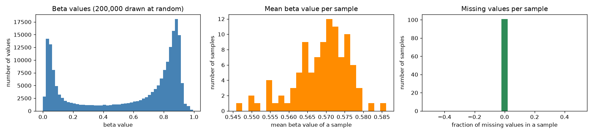
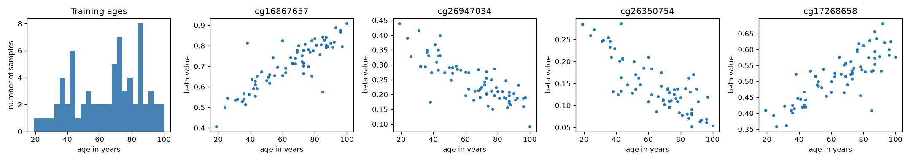
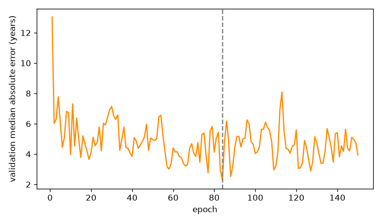
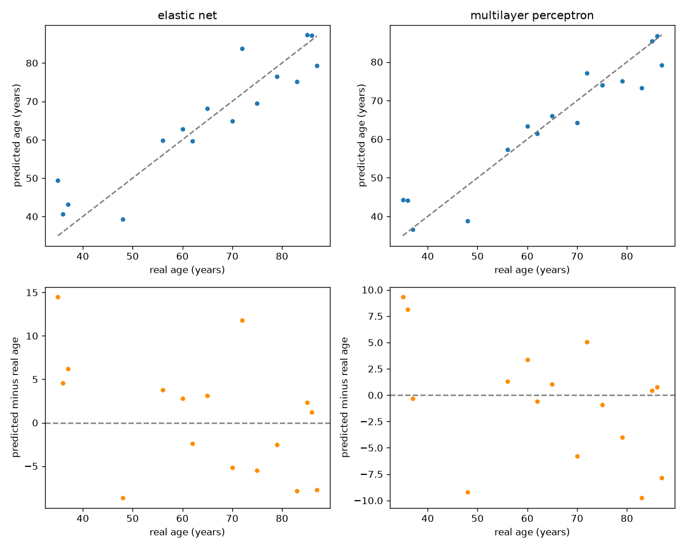

# Predicting age from blood DNA methylation
### *ComputAge Bench Analysis, using Elastic Net and Multilayer Perceptron (MLP)*

## Topic
This project predicts a person's age in years from the methylation of their blood deoxyribonucleic acid, using one healthy whole-blood study from the ComputAge Bench dataset<sup>1</sup>, and compares an elastic net with a small multilayer perceptron written in PyTorch.

## Repository structure and data sources
| Path | What it is | Source and how it was obtained |
|---|---|---|
| `README.md` | Description, setup, notes, results and references | |
| `requirements.txt` | Pinned package versions | |
| `.gitignore` | Files that Git should not track | |
| `LICENSE` | Licence of the code | |
| `ComputAge_Bench_analysis.ipynb` | The analysis notebook, saved with its outputs | |
| `metadata/computage_train_meta.tsv` | Table of the training samples: study, platform, tissue, cell type, gender, age, condition| Downloaded automatically by the notebook from the ComputAge Bench dataset on Hugging Face<sup>7</sup>|
| `data/train/computage_train_data_GSE179325.parquet` | Beta values of the chosen study, 314.5 megabytes (not committed - located in .gitignore) | Downloaded automatically by the notebook from the same dataset<sup>7</sup> |
| `results/` | Figures, a results table and two files of numbers made by the notebook | Created by the notebook |

## Setup
1. Create a virtual environment in the project folder:

   ```text
   python -m venv .venv
   ```

2. Activate it:

   ```text
   # Windows (PowerShell) - the one I used
   .venv\Scripts\Activate.ps1

   # macOS and Linux
   source .venv/bin/activate
   ```

3. Install the packages:

   ```text
   pip install -r requirements.txt
   ```

4. Open the notebook and select the `.venv` environment as its kernel:
   - **Visual Studio Code *(used for this project)*:** click *Select Kernel*, and choose `.venv`.

5. Run `ComputAge_Bench_analysis.ipynb` from top to bottom. Step 2 downloads the metadata table and one study file (314.5 megabytes) into the folders `metadata` and `data`. The table in memory takes about 0.3 gigabytes. No graphics card is needed; the run documented here used the processor only.

## Intro
Methylation is a chemical mark that can sit on deoxyribonucleic acid at places called methylation sites (cytosine-phosphate-guanine sites, written CpG sites). A microarray measures, for every site, a beta value: the fraction of molecules in the sample that carry the mark, from 0 (none) to 1 (all)<sup>1,2</sup>. At some sites this fraction changes with age, so the beta values of many sites together can be used to predict age.

The elastic net is a linear model that adds two penalties to keep the weights small, so that many weights become exactly zero. It is designed for the case where there are many more predictors than samples<sup>3</sup>, which is the case here. It is fitted with ElasticNetCV from scikit-learn<sup>4</sup>. The multilayer perceptron is a small neural network of three fully connected layers, built with PyTorch<sup>5</sup> and trained with the AdamW optimiser<sup>6</sup>.

The main measure is the median absolute error in years on test donors who were never used for any choice. Every model is shown next to two baselines that ignore the methylation values: always guessing the mean training age, and always guessing the median training age. Everything is repeated with seeds 0, 1 and 42.

## Results and conclusions
All numbers come from the test donors of the saved notebook. The mean and standard deviation are over seeds 0, 1 and 42. Each seed has its own split: 70 training donors for seed 0, and 16 test donors for every seed.

| Model | Median absolute error in years | Mean absolute error in years | Correlation |
|---|---|---|---|
| baseline: mean age | 15.46 (2.44) | 16.05 (2.09) | not defined |
| baseline: median age | 13.33 (2.75) | 15.29 (2.65) | not defined |
| elastic net | 4.94 (1.05) | 6.26 (0.55) | 0.89 (0.06) |
| multilayer perceptron | 5.30 (1.80) | 6.31 (2.37) | 0.92 (0.03) |

A correlation is not defined for a baseline, because it predicts one number for everybody. The standard deviation shows only the effect of different random splits and starts, not the small size of the test set.

Median absolute error on the test donors, seed by seed:

| Seed | Baseline: mean age | Baseline: median age | Elastic net | Multilayer perceptron |
|---|---|---|---|---|
| 0 | 15.50 | 13.50 | 4.88 | 3.69 |
| 1 | 17.89 | 16.00 | 3.92 | 7.24 |
| 42 | 13.00 | 10.50 | 6.03 | 4.97 |

For seed 0, the 95 percent bootstrap interval of the median absolute error is 2.78 to 7.73 years for the elastic net and 0.91 to 7.99 years for the multilayer perceptron. The elastic net kept 126 of the 2,000 sites with a weight different from zero, and the network's best epoch was 84 of 150.

- **Against the baselines.** In this study, both models had a much lower test error than both baselines in every seed. The mean median absolute error was 4.94 years for the elastic net and 5.30 years for the network, against 15.46 and 13.33 years for the two baselines.
- **Between the models.** The study cannot separate them. The network had the lower error for seeds 0 and 42, the elastic net for seed 1, and the difference between the models is smaller than the spread between seeds. The bootstrap intervals for seed 0 overlap strongly.
- **Leakage.** Choosing the sites with all donors, test donors included, gave an elastic net test error of 3.84 years for seed 0, against 4.88 years for the correct pipeline. The leaky pipeline looked about one year better, which shows why the choice of sites must use training donors only.

### Figures
All figures are made by the notebook and saved in `results/`.

**Overview of the beta values of the chosen study** (`data_overview.png`): the distribution of 200,000 beta values drawn at random, the mean beta value of each sample, and the fraction of missing values of each sample.



**First look at the training donors** (`first_look.png`): the ages of the training donors, and the beta value against age for the four sites most correlated with age.



**Learning curve of the network, seed 0** (`network_learning_curve.png`): the median absolute error on the validation donors after every epoch. The dashed line marks the epoch that was kept.



**Predicted against real age on the test donors, seed 0** (`predicted_against_real.png`): the top row shows predicted against real age for the elastic net and the network, the bottom row the predicted age minus the real age. The dashed line in the top row is where a perfect prediction would lie.



### Environment used
| Item | Version or detail |
|---|---|
| Operating system | Windows 11, version 10.0.26300 |
| Python | 3.14.7 |
| Visual Studio Code | `1.146` |
| Computing | Processor only, no graphics card (PyTorch build 2.15.0+cpu) |
| Date of setup | `15/11/2026` |

### Package versions
The exact versions are pinned in `requirements.txt` and were printed by Step 1 of the notebook.

| Package | Version |
|---|---|
| torch | 2.15.0 (processor-only build) |
| numpy | 2.5.3 |
| pandas | 3.0.5 |
| scikit-learn | 1.9.1 |
| matplotlib | 3.11.2 |
| pyarrow | 26.0.1 |
| huggingface_hub | 2.4.0 |
| ipykernel | 7.4.0 |

## References
1. Kriukov D, Efimov E, Kuzmina EA, Khrameeva EE, Dylov DV. ComputAgeBench: epigenetic aging clocks benchmark. *bioRxiv*. Preprint published online 2024. doi:10.1101/2024.06.06.597715
2. Du P, Zhang X, Huang CC, et al. Comparison of Beta-value and M-value methods for quantifying methylation levels by microarray analysis. *BMC Bioinformatics*. 2010;11:587. doi:10.1186/1471-2105-11-587
3. Zou H, Hastie T. Regularization and variable selection via the elastic net. *J R Stat Soc Series B Stat Methodol*. 2005;67(2):301-320. doi:10.1111/j.1467-9868.2005.00503.x
4. Pedregosa F, Varoquaux G, Gramfort A, et al. Scikit-learn: machine learning in Python. *J Mach Learn Res*. 2011;12:2825-2830.
5. Paszke A, Gross S, Massa F, et al. PyTorch: an imperative style, high-performance deep learning library. In: Wallach H, Larochelle H, Beygelzimer A, d'Alché-Buc F, Fox E, Garnett R, eds. *Advances in Neural Information Processing Systems 32*. Curran Associates, Inc.; 2019:8024-8035.
6. Loshchilov I, Hutter F. Decoupled weight decay regularization. In: *International Conference on Learning Representations*. 2019. arXiv:1711.05101
7. ComputAge Bench. Hugging Face. Accessed November 18, 2026. https://huggingface.co/datasets/computage/computage_bench


